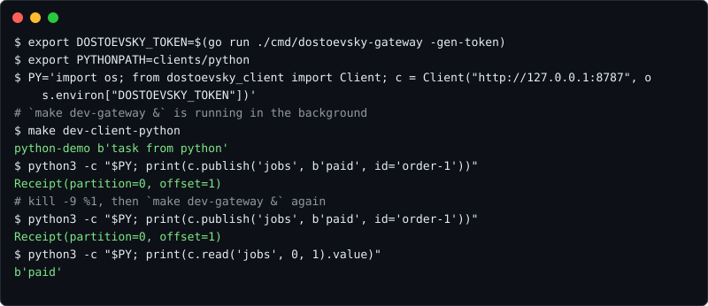

# Dostoevsky

<p>
<a href="https://go.dev/doc/devel/release"></a>
<a href="LICENSE"></a>

<a href="https://github.com/rodriveracom/dostoevsky/releases"></a>
</p>

**Once Dostoevsky says yes, the record is on disk: durable streaming from one small Go server with no dependencies.**

Dostoevsky keeps topics, idempotent publish and consumer checkpoints in one fsync-backed journal. Run it as a server and call it from Python, JavaScript/TypeScript, Java and Rust over HTTP, or embed it in a Go program. A native binary protocol server is in review and is not on `main` yet ([status](#status)).

<p align="center">

</p>

<sub>A real run of the quick start below, captured by <code>scripts/readme_capture.py</code>.</sub>

## Quick start

On Linux or macOS with Go 1.22+, Python 3.10+, Git and Make. Start the gateway in the background, on loopback port 8787:

```sh
git clone https://github.com/rodriveracom/dostoevsky.git && cd dostoevsky
export DOSTOEVSKY_TOKEN=$(go run ./cmd/dostoevsky-gateway -gen-token)   # keep it secret
make dev-gateway &            # wait for the "listening" line
```

Then publish and read:

```sh
export PYTHONPATH=clients/python
make dev-client-python        # publishes a job, reads it back, saves a checkpoint
PY='import os; from dostoevsky_client import Client; c = Client("http://127.0.0.1:8787", os.environ["DOSTOEVSKY_TOKEN"])'
python3 -c "$PY; print(c.publish('jobs', b'paid', id='order-1'))"
```

Now kill the gateway with `kill -9 %1`, start it again with `make dev-gateway &`, and run the last line once more. It returns the same offset: the record survived, and the repeated ID did not create a second one. `kill %1` stops the gateway when you are done.

JavaScript, TypeScript, Java and Rust: [client guide](docs/clients.md). In Go, [embed the library](#embed-it-in-go) instead.

## What makes it different

* **Acknowledged means synced.** A publish returns after the journal is synced to disk. Concurrent writers share a sync.
* **Retries are safe.** Publishing again with the same ID returns the original offset, until retention removes the record.
* **State and offset commit together.** A consumer's checkpoint and its processor state are one journal entry.
* **Library or server.** The same journal runs inside a Go program or behind a gateway with clients for Python, JavaScript, TypeScript, Java and Rust.
* **Small.** Standard library only. On the published [publisher gate](docs/publisher-gate.md) it peaked at 11.1 MiB where embedded JetStream used 43.6 MiB.

**Choose something else if** you need replication or automatic failover (each partition has one durable copy), the highest server throughput (Redis Streams was ahead in every cell [we measured](#measured-results-language-clients)), or a fast restart over a long history (Dostoevsky replays its whole journal when it opens).

<p align="center">

</p>

## Measured results: language clients

**Redis Streams has the highest throughput in all 12 cells below.** Dostoevsky was measured **over HTTP/1.1** through its gateway; Kafka, NATS and Redis used their native protocols. These numbers say nothing about Dostoevsky's native protocol. A rerun with it is planned for 2 December 2026.

Median records per second (median p99 in ms), 5 trials of 120 s each, 512-byte records, acknowledged after each engine's durable acknowledgment, loopback on one Linux ARM64 host with ext4:

| Client | Producers | Dostoevsky (HTTP) | Kafka 4.4.0 | NATS 2.15.3 JetStream | Redis 8.12.0 Streams |
|---|---:|---:|---:|---:|---:|
| Python | 1 | 561 (4.44) | 339 (7.45) | 500 (4.76) | 625 (4.27) |
| Python | 8 | 1,908 (9.46) | 407 (37.70) | 740 (21.38) | 2,395 (7.83) |
| Python | 32 | 2,825 (26.88) | 405 (141.60) | 804 (69.87) | 5,505 (14.94) |
| JavaScript | 1 | 270 (7.16) | 351 (7.09) | 581 (4.27) | 643 (4.10) |
| JavaScript | 8 | 1,309 (22.47) | 407 (37.70) | 778 (18.42) | 2,756 (6.74) |
| JavaScript | 32 | 2,181 (51.83) | 376 (150.32) | 798 (71.27) | 8,249 (8.06) |
| Java | 1 | 490 (5.15) | 353 (7.67) | 639 (4.14) | 709 (3.90) |
| Java | 8 | 1,980 (10.34) | 389 (43.77) | 833 (18.97) | 3,218 (5.92) |
| Java | 32 | 3,403 (23.15) | 376 (172.78) | 797 (76.41) | 9,046 (8.56) |
| Rust, before the fix below | 1 | 23 (48.35) | 371 (6.67) | 675 (3.86) | 735 (3.82) |
| Rust, before the fix below | 8 | 185 (48.83) | 415 (37.70) | 828 (19.16) | 3,218 (6.48) |
| Rust, before the fix below | 32 | 735 (49.81) | 402 (138.81) | 864 (66.47) | 10,299 (7.45) |

Latency percentiles are upper bin edges, at most 1% above the true value. All 240 trials completed, and every acknowledged record was read back.

* **Server memory:** the Dostoevsky gateway's median peak was 13 to 36 MiB, the smallest in all 36 comparisons. The figure is the sum of each server process's highest sampled resident peak (`VmHWM`): the peaks need not occur at the same time, and pages shared between processes (Redis's append-only-file children) can be counted more than once. NATS used 67 to 76 MiB and Kafka 567 to 645 MiB; Redis's lowest was 53 MiB, and it grows with the records it holds in memory. Whether Dostoevsky's memory stays flat as history grows was **not measured** by this run.
* **Where Dostoevsky loses besides Redis:** NATS is faster with one producer in Java, JavaScript and Rust; Kafka is faster with one producer in JavaScript; the unfixed Rust client was behind every competitor at 1 and 8 producers, and behind NATS and Redis at 32. The Dostoevsky client processes in JavaScript and Java used more memory than most or all competitor clients in those languages.

Durability settings:

| Engine | Server | Producer |
|---|---|---|
| Dostoevsky | `fdatasync` before acknowledgment; concurrent writers share syncs | one record per HTTP request, no retries |
| Redis | `appendonly yes`, `appendfsync always`, `save ""` | one `XADD` per record, no retries |
| NATS JetStream | `sync_interval: always`, file storage, 1 replica | each publish awaits its ack, no retries |
| Kafka | `log.flush.interval.messages=1`, `min.insync.replicas=1`, replication factor 1 (fsync per message is inferred from the setting) | `acks=all`, no idempotence, no retries; `linger.ms=0` where set (Python also `batch.num.messages=1`), KafkaJS one message per send |

These settings are read from the source; the run did not trace `fsync` calls. Source commit `d7b967ae805b14817b47a8c83314f3735e100198`. Receipt `HOST.log` SHA-256: `f94a43ce457981f8d76128099a1ebb73caae675d09cfbe2d73a6987fac0201ca` (the receipts are kept in the project's evidence record, not in this repository).

### Rust: the `TCP_NODELAY` fix

The Rust client stalled for about 43 ms per request. [PR 74](https://github.com/rodriveracom/dostoevsky/pull/74), now on `main`, sets `TCP_NODELAY`. A separate alternating A/B on the same host, Dostoevsky only, 5 rounds of 120 s, 30 of 30 trials passing:

| Producers | Before, records/s | After, records/s | Before p99 ms | After p99 ms |
|---:|---:|---:|---:|---:|
| 1 | 23 | 587 | 52.35 | 5.15 |
| 8 | 182 | 2,419 | 54.48 | 8.31 |
| 32 | 728 | 6,617 | 52.35 | 10.65 |

Receipt `HOST.log` SHA-256: `baae763942642f13ca52f6a45edf7c5260955367123e08435c1d29df82f0d27c`. These rows come from a different run and are not a head-to-head with the table above.

## Measured results: embedded Go library

**Durable topics and stateful stream processing that you embed in a Go program: no broker, no dependencies, standard library only.**

| | Dostoevsky | Embedded JetStream | Receipt |
|---|---:|---:|---|
| Throughput, 32 producers, median | **36,422 msg/s** (9x) | 4,020 msg/s | [publisher gate](docs/publisher-gate-results.txt) |
| Peak memory, 32 producers, median | **11.1 MiB** (4x less) | 43.6 MiB | [publisher gate](docs/publisher-gate-results.txt) |
| Runtime dependencies | **none** | NATS server and client | [go.mod](go.mod) |

Synchronous, fsync-backed publishes of 512-byte records to one topic, five alternating trials per point, on shared Linux AMD64 with an overlay filesystem and `GOMAXPROCS=2`. Medians are in [the table](docs/publisher-gate.md); the chart shows every trial. Dostoevsky reopens much more slowly: it replays its whole journal when it opens (that run did not profile where the time goes), and on the ARM64 gate 16,000 records took about 200 ms against 14.5 to 16.9 ms for JetStream (see [reopen time](docs/publisher-gate.md)). The table and chart here are from the AMD64 run; the ARM64 run of the same gate is in [publisher-gate.md](docs/publisher-gate.md), and no macOS numbers are published. Reported percentiles from the newer benchmark receipts are upper bounds, at most 1% above the true value (the upper edge of a 1% histogram bin) for latencies from 1 microsecond to about 6.5 hours; outside that range the bound does not hold; older receipts use the exact sample value, and the two are never drawn in one chart.

<p align="center">

</p>

<p align="center">

</p>

## Status

| Piece | State on 27 November 2026 |
|---|---|
| Embedded Go library | on `main` |
| HTTP gateway; Python, JavaScript/TypeScript, Java and Rust HTTP clients | on `main` |
| [Wire protocol v1](docs/wire-v1.md) (draft) and its Go codec | on `main` |
| JavaScript/TypeScript native client (preview) | on `main`; needs the native server, which is not |
| Native protocol server ([PR 72](https://github.com/rodriveracom/dostoevsky/pull/72)) | in review, council security review pending |
| Native clients: Python ([PR 62](https://github.com/rodriveracom/dostoevsky/pull/62)), Rust ([PR 75](https://github.com/rodriveracom/dostoevsky/pull/75)), Java ([PR 77](https://github.com/rodriveracom/dostoevsky/pull/77)) | in review; wait on PR 72 |

## Embed it in Go

Go 1.22 or later; the module has no dependencies outside the standard library.

```sh
go get github.com/rodriveracom/dostoevsky@latest
```

Publish an event and fold it into durable state. `dir` is any writable directory and `ctx` ends the fold, which otherwise waits for more events:

<!-- quickstart:begin -->
```go
node, err := dostoevsky.Open(dir, dostoevsky.Config{Node: "app", Nodes: []string{"app"}, Topics: map[string]int{"orders": 1}})
if err != nil {
	panic(err)
}
defer node.Close()
rec, err := node.Publish(ctx, "orders", dostoevsky.Message{ID: "order-1", Value: []byte("paid")})
if err != nil {
	panic(err)
}
paid := 0
// Fold commits its state and the input offset together, then waits for more events.
_ = dostoevsky.Fold(ctx, node, rec.Partition, "paid", 0, func(_ context.Context, n int, _ dostoevsky.Record) (int, error) {
	paid = n + 1
	return paid, nil
})
fmt.Println("paid events:", paid)
```
<!-- quickstart:end -->

The message ID makes a retried publish idempotent, and the fold's committed state and offset survive a restart. The test `Example_quickstart` compiles and runs exactly this code, and `TestQuickstartMatchesREADME` fails if the README copy drifts.

Next: the [getting started guide](docs/getting-started.md) and [using the library](docs/library.md): concepts, examples, task queues, batching and backups.

## Limits

* Each partition has **one durable copy**. An offline owner makes its partitions unavailable, and disk loss needs a backup. There is no replication, automatic failover or automatic retention.
* History stays until an application calls `Retain`. Disk use, restart time and index memory grow with it.
* Values are limited to 1 MiB and keys to 4096 bytes.
* The gateway token grants access to every topic. [Read this before exposing the gateway](docs/clients.md#security-read-this-before-exposing-the-gateway).

The full list, with retention, backups and deployment: [operating Dostoevsky](docs/operating.md).

## Documentation

[Getting started](docs/getting-started.md) · [Client guide](docs/clients.md) · [Using the library](docs/library.md) · [Operating](docs/operating.md) · [How it works](docs/how-it-works.md) · [Integrations](docs/integrations.md) · [Changelog](CHANGELOG.md)

## Contribute

Open an issue describing the problem, with a failing test when you can. For a change, fork the repository, branch, and run `make verify` (format, vet, tests, race detector, example build) before opening a pull request. Keep changes small and focused, and add or update tests and the CHANGELOG. Contributions are accepted under the MIT license.
