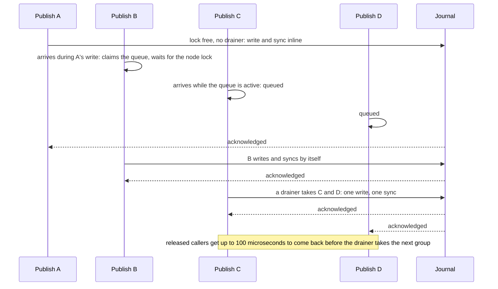

# How Dostoevsky works

This page explains the mechanisms behind the numbers in the [README](../README.md): what an acknowledgment means, why throughput rises with producers, how a fold stays consistent across a crash, and where the sketches and the memory limits are. Every claim names the test or receipt that backs it.

## Group commit: why more producers means more throughput

A durable publish is dominated by one operation: the sync that makes the record survive power loss. Dostoevsky pays that cost once per group of callers, not once per call.



This is how the code behaves on main. The first contender (B) writes alone; callers that join the queue share a group, and the drainer waits briefly for the callers it just released so that the next group is as full as the load allows.

- A call that finds no drainer active and the node lock free writes inline, with no queue bookkeeping. While a drainer is active the call joins the queue instead: it must not write alone in the gap between two groups.
- A call that finds the node busy and no queue active becomes the first contender: it marks the queue active, waits for the node lock and writes its own record by itself.
- Calls that arrive while a queue is active wait in a bounded queue: at most 64 calls and 1 MiB of topic, key, ID and value bytes. When it is full, further callers wait on the node lock, which is the backpressure.
- After the first contender's write, a drainer goroutine takes everything queued, encodes it into one buffer, writes it, syncs once and releases every caller in the group with its own receipt. That single write is the eligible-batch path: if validating the batch fails (wrong owner, a conflicting ID, invalid input, a limit), the calls are written one by one instead, so one bad call cannot reject its neighbors; a call that was cancelled before the group formed, or that repeats an ID already written, needs no write.
- **Gathering.** With many synchronous producers every caller of a group is waiting for that group, so the queue is empty the instant the group is released. A drainer that took the empty queue would exit, the next arrival would write alone and the rest would pile up behind it, so groups would alternate between one and many. After releasing a group of two or more, the drainer therefore waits for about as many calls to be pending as it released, or 100 microseconds, whichever comes first, before it takes the next group. A single caller never waits, and the wait happens after the group's callers were released, so it never delays an acknowledgment. When the queue is empty at the end of a wait, the drainer hands the queue back and the next call finds a free lock.
- Nobody is acknowledged before the sync that covers their record. If the sync fails the whole group fails and the node refuses further writes until it is reopened.

With one producer there is nothing to share, so throughput is bounded by one sync per record. With many producers, groups of queued callers share a sync, so each sync covers many records. The [publisher gate](publisher-gate.md) measures this: medians of 4,005, 13,252 and 36,422 messages/s at 1, 8 and 32 producers. **Those figures were measured before the drainer gathered.** A same-host A/B on production-03 of the build without and with gathering showed higher throughput at 8 and 32 producers and no change at 1 producer; its receipts will be added to this repository with the final comparison run, and the numbers on this page will then be replaced.


Code: `publish_queue.go`. Tests: `TestQueuedPublishIsolation`, `TestQueuedWriteFailure`, `TestQueuedSyncFailureAfterWrite`, `TestQueuedAdmissionAndCancel`, `TestConcurrentPublishKill`, and for the gathering `TestGatherDoesNotDelayALoneCaller`, `TestGatherStopsWhenTheReleasedCallersHaveReturned`, `TestGatherIsBounded` and `TestDrainerTakesGatheredCallersAsOneGroup`.

A group is not a transaction. A crash can persist a prefix of it, so retry each publication with its original ID.

## The durability contract

**Acknowledged means the frame is on disk after a sync.** On Linux a journal append uses `fdatasync`, which flushes the data and the file size needed to read it back. The first write of a new journal, recovery of an existing one, retention, backup and every directory sync use a full `fsync`. Other platforms call `File.Sync` for every sync. See [the benchmark notes](publisher-gate.md) before comparing numbers across operating systems.

**What is on disk.** One append-only file per node, `journal.v1`, holds checksummed frames: a 20-byte header (signature, length, payload checksum, header checksum) and a JSON payload. A record, a consumer checkpoint, a retention seed and the topic manifest are all frames.

**What happens on open.** Recovery replays every complete frame and rebuilds the index. A torn final frame is cut off. A frame that fails its checksum stops recovery with an error that names the offset, because that is corruption, not a crash. Recovery then syncs the accepted prefix before any new write is acknowledged. `Node.Truncated` reports a torn frame that was cut off.

**When open refuses.** A damaged frame is not removed on its own: that could discard acknowledged records. An operator decides, with `dost-repair`. Run it **on the host that holds the data directory, as the user that owns it, with the application stopped; no sudo**:

```sh
go run ./cmd/dost-repair -data /path/to/data            # inspect: changes nothing
go run ./cmd/dost-repair -data /path/to/data -repair    # copy what follows the last good frame aside, then truncate
```

The copy is `journal.v1.damaged-<time>` in the same directory. If frames that verify follow the damage, repair refuses, because truncating would lose them: restore a [backup](../README.md), or add `-discard-later-frames` to lose them knowingly. The damaged frame itself may have been acknowledged. Inspecting needs write permission too, because it takes the directory's lock. The tool checks frames, not their meaning: it cannot fix a journal whose intact frames contradict each other. The same is available in Go as `InspectJournal` and `RepairJournal`.

**A directory written by 0.2.x** is not opened as it is: `Open` returns `ErrUpgradeRequired` and changes nothing, because upgrading is one way. On the host that holds the directory, as its owner, with the application stopped, no sudo: copy the directory somewhere safe, then

```sh
go run ./cmd/dost-repair -data /path/to/data -upgrade
```

It keeps `journal.v1.pre-upgrade-<time>` as well, so the directory needs free space for a second copy of the journal; delete it once the upgraded directory has been opened and checked and you will not go back. To go back, restore your copy and run the old version. A directory that 0.3.0 or later has already opened needs nothing.

**Bounding the history.** The journal, the in-memory index and the time `Open` takes all grow with the records and checkpoints that are kept; `Open` replays the whole file. The index holds a file position for every retained record (16 bytes on a 64-bit host, before allocator overhead) plus a map entry for each record with an ID. `Node.JournalSize` reports the file's size. Two tools bound it:

- `Node.Retain` removes records every consumer group has committed past. It rewrites the journal, so it needs free disk space for the copy.
- `Node.SetJournalCap` (gateway: `-max-journal-mib`) refuses publishes with `ErrJournalFull` instead of letting the file pass the cap. Commits get a further reserve (an eighth of the cap, at least 4 MiB) so that consumers can still advance and `Retain` can then make room. The cap is per process: set it after each `Open`. There is no cap by default.

**Who proves it.** These tests kill a real child process or inject a failure at each step:

| Test file | What it establishes |
|---|---|
| `crash_batch_test.go` | A SIGKILLed writer leaves a prefix; every acknowledged record is recovered at its offset; a torn tail is truncated; a corrupt frame stops recovery without truncating; recovery syncs a clean tail. |
| `publish_queue_test.go` | A SIGKILL with one and with eight concurrent publishers loses no acknowledged record and retries return the original offsets. |
| `retention_fault_test.go`, [crash points](retention-crash-points.md) | Failure at every write, sync, rename and directory-sync step of `Retain` leaves either the old journal or the new one, never a mix; repeated compaction without reopening keeps everything; a failure after the rename fails the node closed. |
| `fence_test.go`, `scripts/fence-check.sh` | A 0.3 or later directory is refused by the real 0.2.3 reader instead of being misread; the replaced journal file is fenced rather than left empty. |
| `backup_test.go` | Backup builds in a hidden sibling and renames only a complete, synced copy; an interrupted backup is refused on open. |

**What it does not establish.** Power-loss behavior on a particular filesystem and disk, replication and failover. Each partition has one durable copy.

## Fold: state and offset move together

`Fold` reads a partition from the group's checkpoint, applies your reducer to each record and commits the new state and the next offset as one journal entry (`Commit` compares the expected cursor, so competing commits against the same cursor have exactly one winner).

```go
dostoevsky.Fold(ctx, node, partition, "paid-count", 0,
    func(_ context.Context, count int, e dostoevsky.Record) (int, error) {
        return count + 1, nil
    })
```

There is no window where the state advanced and the offset did not, or the reverse. After a crash the fold resumes from the last committed pair, so the **state** reflects each record exactly once. The reducer itself may run again for the record that was in flight, so keep it pure: any effect outside the fold (an HTTP call, a write to another store) must be idempotent or be derived from the committed state. `Pipe` applies the same idea to a transformation from one topic to another: the output gets a deterministic ID derived from the input, so replay after a lost response cannot publish it twice.

## Partitioning

A key selects a partition with FNV-1a, `hash(key) mod partitions`. Each partition numbers its records with contiguous, zero-based offsets, and different partitions have no order relative to one another. Consumer groups are independent: each keeps its own checkpoint per partition, so two groups can replay the same records. Topics can be declared in the manifest or, with a wildcard, created on first use. Peers in a mesh route each partition to its owner over HTTP.

## Notifications

A reader that waits for new data should not poll. `Notifications[K]` lets a subscriber wait on any comparable key, such as a partition or an account ID, not only on a partition. The pattern is: subscribe, check the durable state, wait, release, and check again. A signal is a hint sent after a commit, never the data itself, so a missed or extra wake-up costs a re-read and nothing else.

## Sketching: bounded memory, stated error

The `sketch` package (standard library only) is for telemetry, not for decisions.

- **HyperLogLog** counts distinct values in `2^p` bytes for precision `p` from 4 to 18. It hashes with SHA-256, merges across workers and has a versioned binary encoding.
- **LatencyHistogram** keeps 960 fixed buckets, 7,688 bytes, however long the run. `PercentileUpper` returns the upper bound of the nearest-rank percentile, which is exact through 31 ns and exceeds a positive sample by less than 6.25%.


The chart is generated from [the accuracy receipt](sketch-accuracy-results.txt) (`make sketch-report`). Sizes differ in kind: the chart labels a HyperLogLog by its serialized bytes (`2^p` plus a 5-byte header) and the histogram by its bytes in memory. In that run HyperLogLog error was 0.13% to 1.7% at precision 10 to 14 and the histogram's upper-bound error was 0.6% to 3.8%. **Do not** use a sketch where an answer must be exact: records, producer IDs, offsets and delivery decisions stay exact.

## Memory: what is in RAM and what is not

- **In RAM:** per partition, the location of every record (an offset and a length) and the producer IDs after the first. The first record's location and ID are stored inline, and the tail index, waiters and checkpoint maps are created on demand.
- **On disk:** payloads, read back by position when a consumer asks for them.
- **In the gate run:** 16,000 records and one topic, peak RSS for the whole process was 9.7 to 11.3 MiB across trials against 42.9 to 43.9 MiB for embedded JetStream ([receipt](publisher-gate-results.txt)). Per-record index cost grows with the number of retained records, so a large retained journal costs memory, and one million single-record topics measured 163 MiB of live heap ([notes](embedded-performance.md)).
- **Limits you should plan for:** startup scans the whole retained journal, so reopen time grows with it (43 to 120 ms across the gate's trials of 16,000 records, against 9 to 23 ms for JetStream: see the chart below). There is no startup snapshot and no on-disk index yet. `Retain` shortens the journal, rewrites it under the node lock and needs room for a second copy while it runs.


